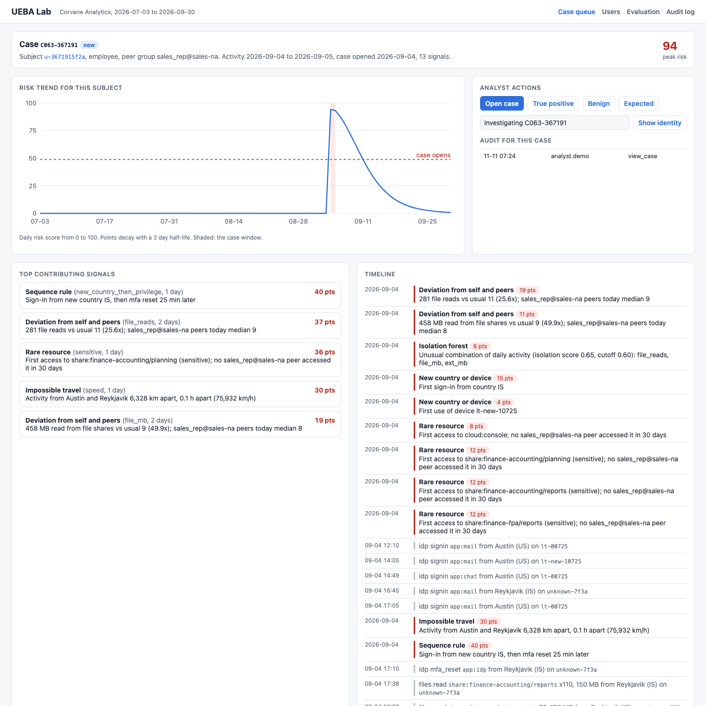
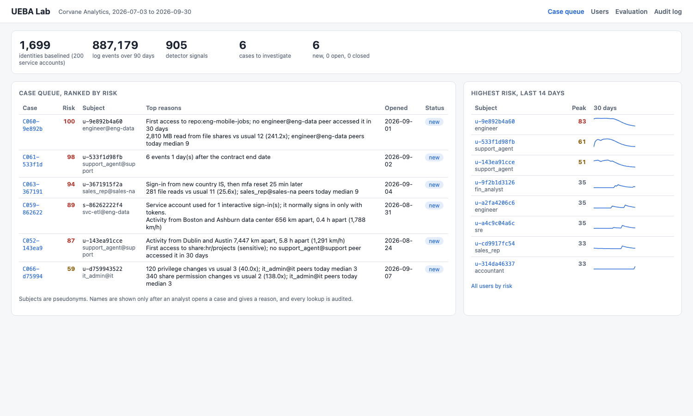
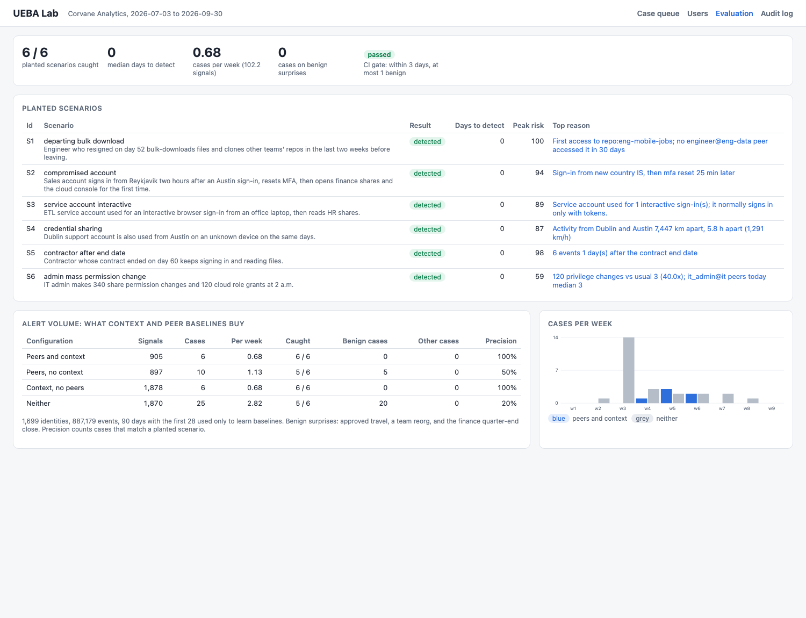
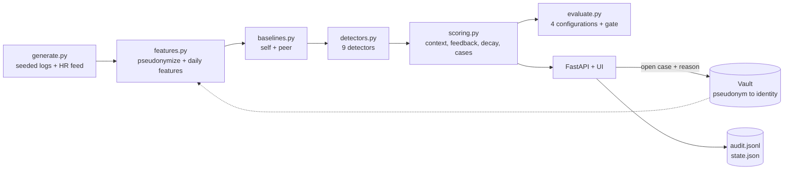

# UEBA Lab



User and entity behavior analytics for a made-up company, Corvane Analytics. It generates 90 days of seeded security logs for 1,499 employees and 200 service accounts (887,000 events across identity provider sign-ins, VPN, file shares, source code, email, cloud console, and badge entry), learns what normal looks like for every identity and its peer group, scores anomalies, and turns about 900 detector signals into 6 cases with a timeline and the top reasons. Analysts work only with pseudonyms until they open a case and give a reason to see a name, and every view is audited. Defensive security only.

## Results

Seed 7, full scale. The first 28 days only train baselines; the remaining 62 days (8.9 weeks) are scored.

| Id | Planted scenario | Starts day | Detected | Days to detect | Peak risk | Top reason |
|---|---|---|---|---|---|---|
| S1 | departing employee bulk download | 60 | yes | 0 | 100 | First access to repo:eng-mobile-jobs; no engineer@eng-data peer accessed it in 30 days |
| S2 | compromised account | 63 | yes | 0 | 94 | Sign-in from new country IS, then mfa reset 25 min later |
| S3 | service account used interactively | 59 | yes | 0 | 89 | Service account used for 1 interactive sign-in; it normally signs in only with tokens |
| S4 | credential sharing | 52 | yes | 0 | 87 | Activity from Dublin and Austin 7,447 km apart, 5.8 h apart (1,291 km/h) |
| S5 | contractor after end date | 61 | yes | 0 | 98 | 6 events 1 day after the contract end date |
| S6 | admin mass permission change | 66 | yes | 0 | 59 | 120 privilege changes vs usual 3 (40.0x); it_admin@it peers today median 3 |

Alert volume with and without context and peer baselines (same signals, same thresholds):

| Configuration | Signals | Cases | Cases per week | Scenarios caught | Cases on benign surprises | Other cases | Precision |
|---|---:|---:|---:|---:|---:|---:|---:|
| Peers and context | 905 | 6 | 0.68 | 6 / 6 | 0 | 0 | 100% |
| Peers, no context | 897 | 10 | 1.13 | 5 / 6 | 5 | 0 | 50% |
| Context, no peers | 1,878 | 6 | 0.68 | 6 / 6 | 0 | 0 | 100% |
| Neither | 1,870 | 25 | 2.82 | 5 / 6 | 20 | 0 | 20% |

What the numbers say:
- Case building is the main volume cut: about 900 signals become 6 cases, under one per week for a 1,700 identity company.
- Context does two jobs. Approved travel and the reorg would otherwise raise 5 cases, and the contractor (S5) is only caught because the HR feed says the contract ended. Without context, S5 is missed.
- Peer baselines halve the raw signals (1,878 to 905), mostly first access to resources that the rest of the team already uses. With context on, the case count is the same either way, because the team change context also damps the reorg. With neither, the reorg alone opens 14 cases and travel 5.
- Every scenario is caught on its first day. That is because each one is loud on day one in this data: 120 role grants at 2 a.m., an MFA reset 25 minutes after a sign-in from a new country. Slow, quiet versions would take longer.
- Seeds 1, 2, and 3 also pass the gate: 6 of 6 caught (S4 took 2 days once), 0 cases on benign surprises, 6 or 7 cases in total, 0 or 1 unexplained.
- The scenarios, the noise, and the detectors were written by the same person, so these are regression numbers for this simulation, not a claim about real logs. Thresholds (case at 40 decayed points, z of 4 against self and 3 against peers) were set by looking at this data.

The background includes unlabeled noise that counts against precision when it opens a case: trips nobody filed with HR, laptop refreshes, crunch days with late nights, people reading another team's shares, and ordinary resignations with ordinary behavior.

| Case queue | Evaluation |
|---|---|
|  |  |

Dark mode: [docs/case-dark.png](docs/case-dark.png).

## Why

A security team that alerts on every odd login drowns: a company this size produces hundreds of statistical oddities a week, and almost all of them are travel, reorgs, quarter-end, or someone getting a new laptop. The threats that matter (a departing engineer taking code, a phished account, a shared password, a service key used by a person) look like small deviations in several places at once. UEBA earns its keep by comparing each identity to its own past and to its peers, knowing about HR events, combining weak signals over a few days, and handing an analyst a short queue of cases that each explain themselves, while keeping names out of view until there is a reason to look.

## What it does

| Area | How |
|---|---|
| Synthetic logs | 15 teams, 14 roles, 5 offices in 4 time zones, managers, work schedules, contractors with end dates, 5 kinds of service account. Seeded, so every run is the same. |
| Ingestion and privacy | Raw logs carry employee ids. Ingestion replaces them with HMAC-SHA256 pseudonyms (`u-3671915f2a`, key from `UEBA_PSEUDO_KEY`) and rolls them into 17 daily features per identity. Features, baselines, detectors, scoring, and cases never see a name, email, or employee id. |
| Self baseline | Median and scaled MAD in log space over an adaptive window: the last 28 active days, stretched to 56 for sparse identities, reset at a team change, no score until 5 days of history. The spread has a floor of max(0.25, 1/sqrt(1 + median)), so a jump from 0 to 2 is not an outlier. |
| Peer baseline | Same role and team, at least 5 members, falling back to the role across teams, then the team. Peers are compared on the same day, which is what makes a quarter-end spike across all of finance look normal. |
| Detectors | Deviation from self and peers on 14 features; unusual hours; first access to a resource no peer touched in 30 days; new country or device; impossible travel over all located events (above 900 km/h, at least 500 km); sequence rule (new country, then a privilege change within 60 minutes); service account interactive sign-in; activity after an end date; and an isolation forest over daily deviation vectors as a low-weight extra signal (numpy, written from the paper). |
| Risk and context | Points per day, decayed with a 3 day half-life, mapped to a 0 to 100 score. Resignation notice multiplies data movement signals by 1.5. Approved travel multiplies location signals for that country by 0.1. A team change multiplies rare resource and volume signals by 0.3 for 30 days. Quarter-end multiplies finance volume by 0.4. |
| Cases | A case opens when decayed risk reaches 40 points, pulls in signals from the previous 7 days, keeps collecting while risk stays above 10, and lists the top reasons by points. |
| Feedback | True positive raises that pattern (detector and feature) by 1.25 for the peer group. Benign halves it for that subject; expected cuts it to 0.1. Feedback applies from the day after the case, never to the past. |
| Re-identification | Only for a case an analyst has opened, only with a reason, and written to the audit log with the analyst name. Denied attempts are logged too. |

## Architecture



## Run it

```bash
cd ueba-lab
uv sync --python 3.12
uv run pytest -q                     # 104 tests, about 25 s
uv run uebalab eval --gate           # full scale, about 1 minute
uv run uebalab serve --port 8892     # UI at http://127.0.0.1:8892, ready after about a minute
```

`UEBA_SCALE=0.3` starts faster. Other settings: `UEBA_SEED` (default 7), `UEBA_DATA` (where `state.json` and `audit.jsonl` go, default `data/`), `UEBA_PSEUDO_KEY` (the default is a demo key, not a secret). The analyst name comes from the `X-Analyst` header, a stand-in for SSO.

API: `GET /api/cases`, `GET /api/cases/{id}`, `POST /api/cases/{id}/open`, `POST /api/cases/{id}/reidentify`, `POST /api/cases/{id}/feedback`, `GET /api/users`, `GET /api/users/{pid}`, `GET /api/evaluation`, `GET /api/audit`, `GET /healthz`, `GET /metrics`. Logs are JSON lines on stdout.

Makefile: `make install test lint eval gate run screenshot docker-build`. Screenshots come from headless Chrome with the server running (`make screenshot`).

## Tests

104 tests in about 25 seconds:
- Baselines: median and MAD math, the spread floor, a single bad day not moving the baseline, the fast NaN median against numpy, window length, stretching, reset at a team change, warm-up, peer group construction and fallbacks, same-day peer scoring, usual hours.
- Detectors on hand-built logs: volume deviation with and without peers, minimum volumes, rare resources, new country and device, impossible travel at 1 h, 5 h, and 10 h gaps with the speed checked, short hops, sequence timing at 5, 59, 61, and 180 minutes, the service account rule, activity after an end date, night work, and the isolation forest.
- Scoring: decay half-life, case threshold, grouping, lookback, ranking, each context rule (resignation raises, approved travel lowers only the matching country, team change, quarter-end), and feedback (scope, timing, strength).
- Privacy: pseudonyms, no identities anywhere in the analytics layer, the audit log, re-identification denied before opening, required reason, state surviving a restart.
- Evaluation: every scenario caught within 3 days, the gate failing when it should, context catching the contractor, case accounting.
- API end to end with the FastAPI test client.

## DevOps

- `.github/workflows/ci.yml`: ruff and pytest; a detection gate that runs the full-scale evaluation and fails unless every planted scenario becomes a case within 3 days and benign surprises cause at most 1 case (tables go to the job summary); and a Docker build with a container smoke test that opens a case and leaves feedback.
- `Dockerfile`: multi-stage uv build, slim base, non-root user, `/app/data` owned by that user, HEALTHCHECK through `uebalab healthcheck`.
- Docker is not installed on the machine this was built on, so the image and CI are built only in GitHub Actions. Everything also runs with plain `uv run`.

## Production notes

- Ingestion would read from a SIEM or log lake in streaming batches, keep daily features in a columnar store, and score once per day per identity instead of replaying 90 days in memory.
- Geo would come from IP lookups with VPN and cloud egress ranges excluded; impossible travel is the noisiest detector in real deployments for that reason.
- The pseudonym key would live in a KMS with rotation, the vault would be a separate service with its own access policy, and re-identification would need case assignment from the ticketing system, with a second approver for sensitive roles.
- Context would come from HR, travel booking, and change management systems with their own freshness checks, since a stale HR feed silently turns off the contractor rule.
- Thresholds and feedback multipliers would be tuned per business unit from labeled case outcomes, with the evaluation re-run on every change, as the CI gate does here.

## License

MIT. See [LICENSE](LICENSE).
